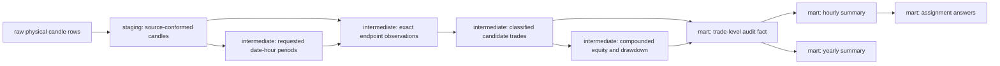

# BTC/USDT Hourly Strategy Backtest

An end-to-end analytics engineering project that loads Binance one-second BTC/USDT candles into PostgreSQL, transforms them with dbt, and compares 24 hypothetical hourly trading strategies. The pipeline is designed to make candidate eligibility, source gaps, duplicate handling, compounding, and drawdown auditable—not just to produce two headline numbers.

## Findings

The recorded full-history run covers eligible trades from **2021-02-23 through 2024-08-27**. Each result below is based on 1,282 eligible trade days.

| Question | UTC entry hour | Result |
|---|---:|---:|
| Greatest compounded return | 22:00 | **42.519%** |
| Smallest maximum-drawdown magnitude | 10:00 | **9.034%** |

These are historical results under the assumptions below, not forecasts or evidence of future profitability. The best of 24 hours was selected after examining the same period, so the winning return is exposed to multiple-comparison and selection bias. The figures are from a previously validated run; run the pipeline on the supplied source file to reproduce and verify them.

## What the strategy measures

Each UTC hour is treated as a separate hypothetical account. On every eligible date, the account enters at that hour’s exact `HH:00:00` candle open and exits at the exact `HH:59:59` candle close. The full resulting balance is reinvested on the next eligible date.

For each eligible trade:

```text
trade factor = exit price / entry price
trade return = trade factor - 1
equity = cumulative product of trade factors, starting from 1.0
drawdown = equity / running peak - 1
```

“Smallest maximum-loss magnitude” is interpreted as the shallowest maximum peak-to-trough drawdown. It is not the smallest losing trade. The backtest excludes fees, bid/ask spread, slippage, latency, market impact, taxes, leverage constraints, and execution failures.

## Data model

The models make the grain and responsibility of each transformation explicit:



Key relations in the `analytics_marts` schema:

| Model | Purpose |
|---|---|
| `fct_hourly_strategy_trades` | One row per requested date-hour, including exclusions, reasons, endpoint diagnostics, and eligible-trade metrics. |
| `agg_hourly_strategy_summary` | All-history coverage, return distribution, compounded return, and drawdown for each of the 24 hours. |
| `agg_hourly_strategy_yearly` | Calendar-year diagnostics and performance, with equity reset each year. |
| `rpt_assignment_answers` | The two deterministic winners used to answer the assignment. |

### Data-quality policy

The source is kept at physical-row grain in raw and staging. At the strategy endpoints, repeated rows are accepted only when the relevant prices agree: entry `open` at the exact start timestamp and valid exit `close` at the exact final-second timestamp. Conflicting prices are not resolved by choosing a maximum or latest record; the price remains unresolved and the candidate is excluded. Any malformed physical copy at the exit timestamp also excludes the candidate. Nearby timestamps are not substituted for missing exact endpoints.

Candidates whose endpoints fall outside the dataset’s overall timestamp window remain visible as `outside_source_window` and are excluded from the in-source coverage denominator. Internal missing endpoints, conflicting prices, nonpositive prices, and malformed exits remain visible with diagnostic counts and statuses.

## Run the project

### Requirements

- Docker with Docker Compose v2
- The assignment CSV in the project root (or provide its path through `DATA_FILE`)
- The container and CI use UV to install the Python dependencies declared in `pyproject.toml`; install UV on the host only if you want a local Python environment

The input header must match this exact, case-sensitive sequence:

```text
Open Time,Open,High,Low,Close,Volume,Close Time,Quote Asset Volume,Number of Trades,Taker Buy Base Asset Volume,Taker Buy Quote Asset Volume,Ignore
```

Copy `.env.example` to `.env` before running. The supplied credentials are for local development. PostgreSQL is bound to localhost; do not expose this Compose configuration as a production database. The source CSV is runtime input and is excluded from version control and the Docker build context.

### End-to-end run

```bash
./run.sh
```

The script starts PostgreSQL, creates the raw relations if needed, loads or reuses the selected source, runs the source-quality audit, installs dbt packages, executes `dbt build`, generates dbt documentation, runs governance checks, and prints the assignment answers plus an endpoint-quality summary.

Optional examples:

```bash
./run.sh --start-date 2024-01-01 --end-date 2024-01-31
DATA_FILE=/absolute/path/to/candles.csv ./run.sh
./run.sh --reload
```

Date bounds are inclusive. `--reload` replaces the raw dataset transactionally and reruns its source audit. Without it, a loaded source is reused only when the selected filename and file size match the latest load audit; same-size content changes are not detected because checksums are not currently calculated. PostgreSQL data persists in the local `postgres_data/` bind mount; `docker compose down` stops services but does not remove that data.

`--hour 0-23` filters the displayed two-row winner report only. It does not restrict model calculations to one strategy, and the report will have no matching row when the chosen hour did not win either question.

### Focused dbt development

After the raw data has been loaded, the dbt commands can be run independently:

```bash
docker compose run --rm dbt deps
docker compose run --rm dbt build
docker compose run --rm dbt test
```

Python dependencies are declared in `pyproject.toml`, which pins `dbt-postgres` directly. A `uv.lock` is not currently committed, so transitive dependency versions are not fully frozen. For a local host-side environment, run `uv sync`; the main workflow does not require host-side dbt because it runs dbt in Docker.

## Validation and observability

- dbt generic and singular data tests check keys, status/eligibility consistency, exact endpoint use, candidate counts, compounding, drawdown, yearly reconciliation, and final-answer cardinality.
- dbt unit tests cover endpoint pairing, duplicate/conflict behavior, malformed exits, eligibility, and equity calculations with deterministic fixtures.
- Public marts enforce dbt model contracts and document columns; a manifest-based governance check validates documentation, contracts, and source-layer boundaries.
- GitHub Actions builds the project against a deterministic two-day PostgreSQL fixture, without downloading or committing the full market-data file.
- `raw.load_audit` records load provenance; `raw.source_quality_audit` retains source-quality results by load. `sql/source_quality_results.sql` displays the latest audit.

The consolidated source audit rejects impossible prices, OHLC relationships, volume relationships, and load-metadata mismatches. Known malformed close timestamps are retained as diagnostics rather than failing ingestion, allowing the transformation logic to exclude affected strategy candidates explicitly.

## Reproducibility and known limitations

- The source’s first and last dates may be partial; such boundary candidates are visible but are not counted as internal endpoint failures.
- Duplicate/conflict resolution is scoped to the two timestamps and price fields used by this strategy. The project does not build a canonicalized full-source candle table or a row-level quarantine system.
- Source identity is checked by filename and file size, not a content checksum.
- Annual results are diagnostic views of historical stability, not out-of-sample validation. A more credible profitability assessment would require pre-defined selection rules, an untouched evaluation period, and realistic transaction costs.
- Generated dbt documentation and build artifacts are written under `target/`; the saved build run result is `target/build_run_results.json`.
